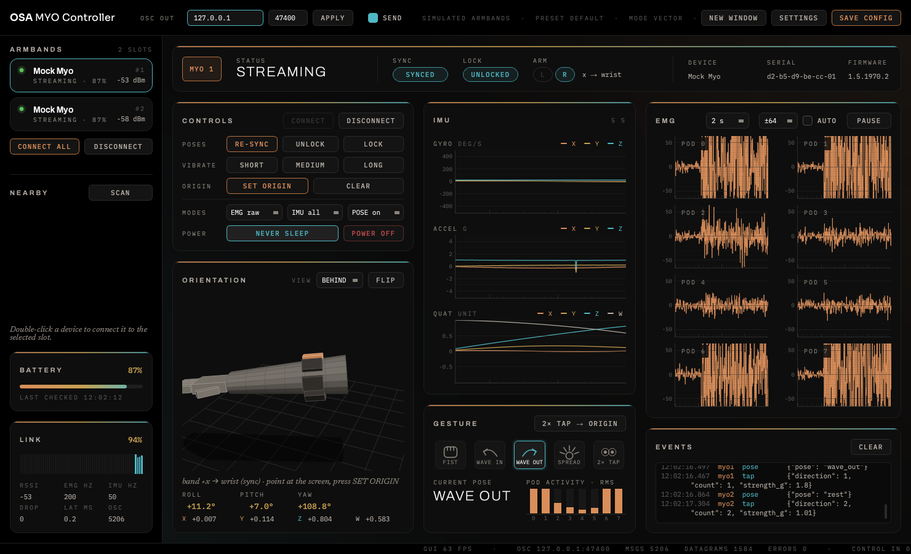
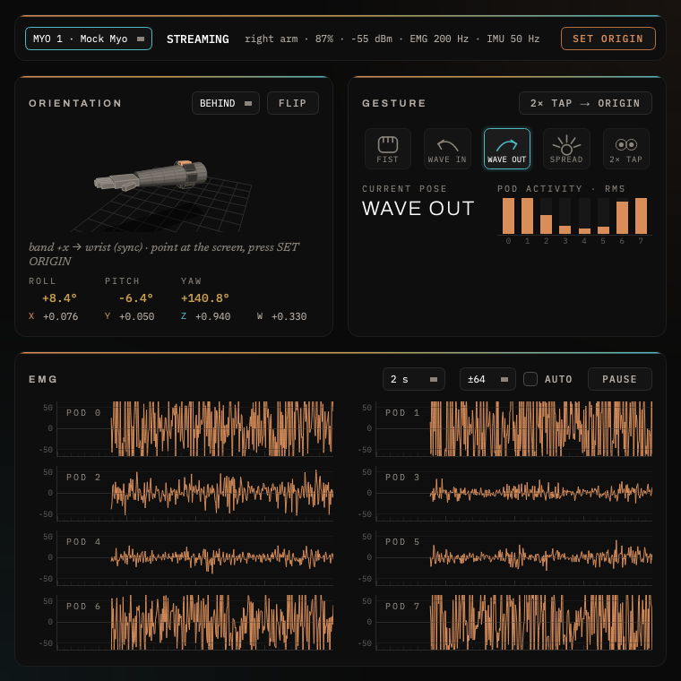
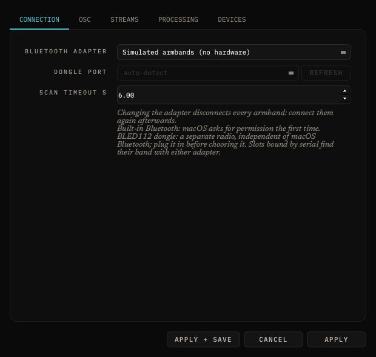
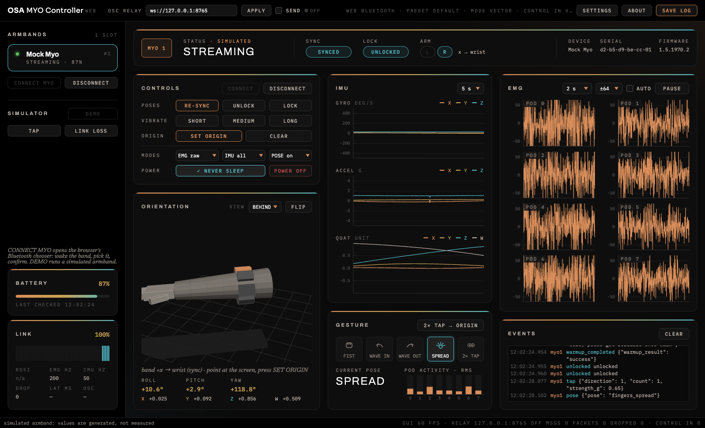

# OSA MYO Controller

A driver, monitor and **OSC** bridge for the **Myo** gesture-control armband on macOS. It
connects to one or more armbands over Bluetooth, shows their muscle (EMG), motion and gesture
data live, and streams it to Max/MSP, Pure Data, SuperCollider, TouchDesigner or anything else
that speaks OSC.



- **Native on Apple Silicon.** Built-in Bluetooth (CoreBluetooth) or the BLED112 USB dongle
  that shipped with the Myo. No Rosetta, no Thalmic SDK, no kernel extensions.
- **Several armbands at once**, each on its own OSC address (`/myo/1/…`, `/myo/2/…`).
- **Everything the band sends:** raw and smoothed EMG, RMS activity, quaternion, Euler angles,
  accelerometer, gyroscope, poses, taps, sync, battery.
- **Two-way OSC:** vibrate, lock / unlock, set the orientation origin, change modes from your
  patch.
- **Built for the stage:** set the origin with a double tap, tap filtering, never-sleep, auto
  reconnect, a configuration that survives a bad edit.
- **Web version** for Chrome and Edge (Web Bluetooth) on macOS, Windows and Linux.

By **Daniele Fabris** and **Simone Arganini** · [Oscilla Creations](https://www.oscillacreations.com)
· MIT licence.

## Install

macOS 12+ (Apple Silicon or Intel), Python 3.11+ and [uv](https://docs.astral.sh/uv/).

```bash
git clone https://github.com/dnlfbr/OSA-MYO-Controller.git
cd OSA-MYO-Controller
uv venv --python 3.12
uv pip install -e ".[gui,dongle]"
source .venv/bin/activate
```

Or build the double-clickable app: `sh packaging/build_app.sh` → `dist/OSA MYO Controller.app`.

> **Bluetooth permission.** macOS only lets an app use Bluetooth if the program that launched
> it asks for it. Run `osa-myo` from **Terminal.app** or iTerm2 (not from an editor's built-in
> terminal) and accept the prompt, or use the .app.

## Quick start

Wake the armband (move it, or plug it into USB and unplug it) and run:

```bash
osa-myo scan              # list nearby armbands
osa-myo run               # monitor + OSC to 127.0.0.1:7400, control on 7401
osa-myo run -n 2          # two armbands: /myo/1 and /myo/2
osa-myo run --mock -n 2   # no hardware: simulated armbands
osa-myo run --no-gui      # headless, OSC only
```

Then **sync** the band: wave your hand outwards and hold until it vibrates. Poses arrive from
then on; `SET ORIGIN` (or a double tap, if enabled) points the orientation at the screen.

Check the stream without Max: `python examples/osc_receiver.py 7400`. A ready-made Max patch
is in [`examples/myo_receiver.maxpat`](examples/myo_receiver.maxpat).

## OSC at a glance

Output, default target `127.0.0.1:7400`. `<id>` is the slot number (1, 2…).

| Address | Values |
|---|---|
| `/myo/<id>/emg/raw` | 8 ints, −128..127, 200 Hz |
| `/myo/<id>/emg/rms` | 8 floats, 0..1, muscle activity per pod |
| `/myo/<id>/emg/mav` | 1 float, 0..1, overall activity |
| `/myo/<id>/quat` | w x y z, origin applied |
| `/myo/<id>/euler` | roll, pitch, yaw (radians; `/euler/deg`, `/euler/norm` too) |
| `/myo/<id>/accel`, `/gyro` | g, deg/s |
| `/myo/<id>/pose` | `rest fist wave_in wave_out fingers_spread double_tap` |
| `/myo/<id>/tap`, `/sync`, `/arm`, `/battery`, `/status` | events and state |

Control, listening on port `7401`: `/myo/<id>/vibrate 1|2|3`, `/lock`, `/unlock`, `/zero`
(set origin), `/mode emg imu classifier`, `/resync`… (`<id>` can be `all`). A
[MyoMapper](https://github.com/balandinodidonato/MyoMapper)-compatible preset keeps old patches
working (`--preset myomapper`).

Full tables, scaling and rates: [docs/guide.md](docs/guide.md#osc-output).

## More windows, settings, web

<p>
  
  
</p>

`NEW WINDOW` opens one band in its own window; `SETTINGS` edits every option of
`config.toml` live.



The **web version** (`web/`) runs the same protocol, monitor and OSC addresses in Chrome or
Edge over Web Bluetooth, for one band; a small relay turns its messages into OSC.

```bash
cd web && npm install && npm run dev   # http://localhost:5173, then CONNECT MYO or DEMO
npm run relay                          # OSC out to 127.0.0.1:7400
```

Details: [web/README.md](web/README.md).

## Documentation

- [User guide](docs/guide.md): permissions, the monitor, streaming modes, full OSC tables,
  configuration, BLED112 dongle, building the app, troubleshooting.
- [Manuale d'uso (italiano)](docs/MANUALE.md).
- [Protocol notes](docs/protocol.md): the Myo's Bluetooth protocol as implemented here.
- [Hardware checklist](docs/hardware-tests.md) and [changelog](CHANGELOG.md).

## Status

Used with physical Myos over the Mac's built-in Bluetooth. The BLED112 dongle backend and the
web version are tested against simulated hardware and unit tests, not yet against a real band.
Open points are listed under [Known unknowns](docs/guide.md#known-unknowns).

## Development

```bash
uv pip install -e ".[gui,dongle,dev]"
pytest                              # Python tests
cd web && npm test                  # web tests
```

Issues and pull requests are welcome.

## Credits and licence

MIT licence, see [LICENSE](LICENSE). Written from Thalmic Labs' public
[`myohw.h`](https://github.com/thalmiclabs/myo-bluetooth) protocol header and by reading the
open-source projects below; no GPL code and no Thalmic SDK binaries or assets are included.
`osa-myo credits` and the app's *About* window list the authors and every library inside the
app (bleak, PyObjC, pyserial, python-osc, NumPy, PySide6 under LGPL-3.0, pyqtgraph, Typer,
tomli-w, PyInstaller). Fonts (Archivo, IBM Plex Mono, Sora, Newsreader) are bundled under the
SIL Open Font Licence.

| Project | Licence | Used for |
|---|---|---|
| [thalmiclabs/myo-bluetooth](https://github.com/thalmiclabs/myo-bluetooth) | Apache-2.0 | UUIDs, commands, data layouts, scale factors |
| [PerlinWarp/pyomyo](https://github.com/PerlinWarp/pyomyo) | MIT | BGAPI commands for the dongle, EMG modes, never-sleep |
| [Crimson-Crow/pymyo](https://github.com/Crimson-Crow/pymyo) | MIT | bleak reference, data formats |
| [jshahbazi/FreeMyo.py](https://github.com/jshahbazi/FreeMyo.py) | MIT | macOS specifics, pairing troubleshooting |
| [iomz/dl-myo](https://github.com/iomz/dl-myo) | GPL-3.0 | protocol knowledge only, no code reused |
| [francesco-di-maggio/pyomyosc](https://github.com/francesco-di-maggio/pyomyosc) | MIT | OSC namespace and control messages |
| [balandinodidonato/MyoMapper](https://github.com/balandinodidonato/MyoMapper) | MIT-style | `myomapper` preset |
| [balandinodidonato/MyoToolkit](https://github.com/balandinodidonato/MyoToolkit) | n/a | pointers to MyoMapper, myo-osc, MyOSC |
| [samyk/myo-osc](https://github.com/samyk/myo-osc) | unstated | historical OSC layout |
| [francocruces/MioConnect](https://github.com/francocruces/MioConnect) | MIT | multi-device lifecycle ideas |
| [cortinico/myonnaise](https://github.com/cortinico/myonnaise) | MIT | command confirmation, keep-alive |

Myo is a trademark of its owners; this project is not affiliated with Thalmic Labs or North.
